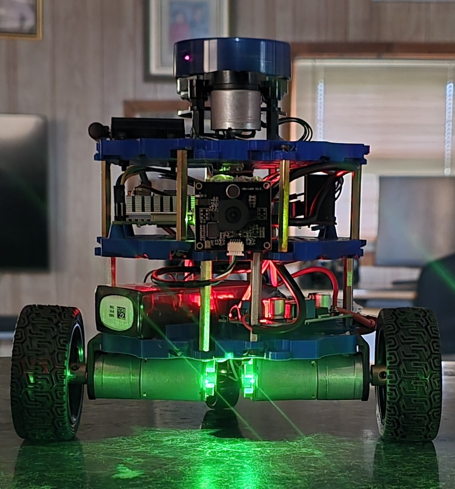

# IndigoBot

ROS2 Jazzy workspace for my Indigobot, concentrating on the Python language.



This is a work in progress

## Hardware

- Raspberry Pi 5, Ubuntu 24.04, ROS2 Jazzy
- Arduino Nano clone (CH340 USB serial)
- L298N motor driver, JGA25-371 encoder motors, 65 mm wheels
- YDLIDAR X2L (CP2102 USB adapter board)
- IMU
- USB camera (UVC, `/dev/video0`)
- 3S LiPo with a buck converter for 5 V
- Three-plate PLA chassis with a rear caster

Wheel radius 0.0325 m, wheel separation 0.170 m.

## Packages

| Package | Purpose |
| --- | --- |
| `indigo_description` | URDF/xacro, including the ros2_control description |
| `indigo_firmware` | `IndigobotInterface` ros2_control hardware plugin (serial to the Arduino) |
| `indigo_control` | diff_drive_controller configuration |
| `indigo_bringup` | Launch files and sensor configuration |
| `indigo_vision` | Camera and vision nodes (Python) |

Serial protocol between the Pi and the Arduino, 115200 baud:

- Pi to Arduino: `CMD,<left>,<right>\n`
- Arduino to Pi: `ENC,<left>,<right>\n`

## Setup on a fresh install

### 1. Clone this repo

```bash
mkdir -p ~/indigobot_ws
cd ~/indigobot_ws
git clone git@github.com:Dwilliestyle/Indigo-Bot.git src
```

### 2. YDLIDAR SDK (system-wide)

```bash
sudo apt install -y cmake pkg-config build-essential
cd ~
git clone https://github.com/YDLIDAR/YDLidar-SDK.git
cd YDLidar-SDK
mkdir build && cd build
cmake ..
make
sudo make install
```

### 3. Lidar ROS2 driver

Not part of this repo (it is in `.gitignore`). Clone it into `src`:

```bash
cd ~/indigobot_ws/src
git clone https://github.com/YDLIDAR/ydlidar_ros2_driver.git
```

### 4. udev rules for stable device names

Gives `/dev/lidar` and `/dev/arduino`, so the two USB serial devices can
enumerate in any order.

```bash
sudo tee /etc/udev/rules.d/99-indigobot.rules << 'EOF'
SUBSYSTEM=="tty", ATTRS{idVendor}=="10c4", ATTRS{idProduct}=="ea60", SYMLINK+="lidar", MODE="0666"
SUBSYSTEM=="tty", ATTRS{idVendor}=="1a86", ATTRS{idProduct}=="7523", SYMLINK+="arduino", MODE="0666"
EOF
sudo udevadm control --reload-rules
sudo udevadm trigger
sudo udevadm settle
ls -l /dev/lidar /dev/arduino
```

### 5. Raise the Pi 5 USB current limit

Without this, the lidar, Arduino and camera together trip the Pi's USB
over-current protection. All USB devices drop out, the lidar crawls and the
Arduino and wheel LEDs flicker or go dark.

```bash
echo "usb_max_current_enable=1" | sudo tee -a /boot/firmware/config.txt
sudo reboot
```

Check with `vcgencmd get_config usb_max_current_enable`.

### 6. USB ports

Plug the lidar and the Arduino into the black USB 2.0 ports. The Pi would
not boot with the lidar in a blue USB 3.0 port.

### 7. Build

```bash
cd ~/indigobot_ws
colcon build
source install/setup.bash
```

## Running

The bringup and the lidar are separate launches, each in its own terminal:

```bash
ros2 launch indigo_bringup <BRINGUP_LAUNCH_FILE>
ros2 launch indigo_bringup <LIDAR_LAUNCH_FILE>
```

Keyboard teleop needs stamped velocity messages:

```bash
ros2 run teleop_twist_keyboard teleop_twist_keyboard --ros-args -p stamped:=true
```

## Lidar notes (X2L)

Config: `indigo_bringup/config/ydlidar.yaml`

- Port `/dev/lidar`
- `support_motor_dtr: true`. With the USB current fix in place the driver
  holds the motor at about 8.5 Hz. With it set to `false` the motor
  free-runs at about 17.7 Hz, which gives fewer points per scan.
- At rest (no driver running) the motor free-runs fast. That is normal for
  this adapter board.

## Troubleshooting

- USB devices dropping out: `sudo dmesg | grep -i over-current`
- Supply check: `vcgencmd get_throttled` (want `0x0`) and `vcgencmd pmic_read_adc EXT5V_V`
- Scan rate: `ros2 topic hz /scan` (want about 8.5 Hz)
- One wheel dead or wheels alternating: suspect the Nano's D2 interrupt pin.
  The right encoder is on D2 and the left on D3.
